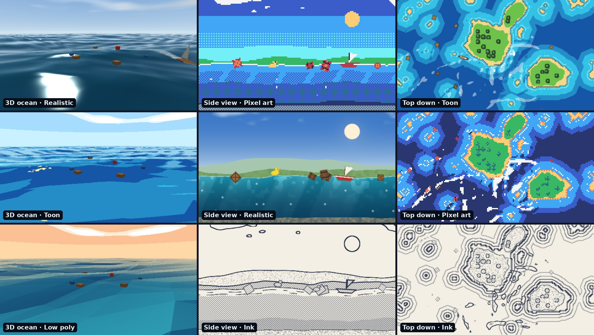

# Water Lite

Stylized real-time water for low-end browser games. It is one JavaScript file with no dependencies, and it runs on WebGL 1 without extensions, which includes old phones and school Chromebooks.



The simulation is identical in every art style; only the drawing changes. A pixel-art game gets the same buoyancy, wakes and ripples as a realistic one.

- **Three views**
  - `3d`: an ocean in perspective. Gerstner waves come from a wind spectrum, and the CPU reads the same heights, so objects float on the waves you see.
  - `side`: a 2D side view for platformers. The surface is a row of springs on top of a swell. Crates, barrels, ducks and boats float, tip and right themselves, and splash when they drop in.
  - `top`: a 2D top-down view for RPGs and strategy games. Ripples follow a wave equation and bounce off coastlines. There are animated shore breakers, caustics in the shallows, trees on the islands, and a boat that leaves a wake.
- **Six art styles:** `realistic`, `toon`, `pixel`, `lowpoly`, `retro` (PS1-style: 15-bit colour, dithering, vertex wobble, scanlines) and `ink` (pen on paper, with hatching and map-style coastlines).
- **Pixel-exact output**
  - The scene renders at low resolution and is scaled up in whole pixels.
  - Palettes: PICO-8, Sweetie 16, Game Boy, Ocean 8 and 1-bit.
  - Ordered dithering that only appears where two palette colours meet.
- **Four quality presets** (`potato`, `low`, `medium`, `high`), which set render scale, wave count, mesh density and simulation size.
- **Fits into your game**
  - Turn the scenery off to keep only the water. The sky and land become transparent, so your own background or tilemap shows through.
  - Pass your own land map to the top view.
  - Read surface heights for your own physics.

About 85 KB of source, 63 KB minified, 22 KB gzipped.

## Try it

Open `lite/index.html` in a browser. The demo has every option, and **Copy code** gives you the exact `new WaterLite(...)` call for what you see.

## Use it

```html
<canvas id="water" style="width: 100%; height: 100%"></canvas>
<script src="water-lite.min.js"></script>
<script>
  var water = new WaterLite(document.getElementById('water'), { mode: 'side', style: 'pixel' });
  var last = performance.now();
  function frame(now) {
    water.update((now - last) / 1000);   // seconds; capped at 0.1 internally
    water.render();                      // sizes the canvas from its CSS size
    last = now;
    requestAnimationFrame(frame);
  }
  requestAnimationFrame(frame);
</script>
```

### In an existing game

- **Water as a layer.** Create the engine with `{ transparent: true, scenery: false }` and put its canvas above or below your game canvas. Only the water is drawn.
- **Your own physics.** `water.sample(x, z)` returns the surface at a point:
  - 3D: `{ height, normal }` at world `x, z`.
  - Side view: `{ height }` at `x` in view units (up is positive).
  - Top view: the ripple height at world `x, y`.
- **Things floating.** `water.addFloater(x, y, { kind, size, density })` adds a body that the engine simulates and draws.
  - Kinds in the side view: `crate`, `barrel`, `duck`, `boat`.
  - Top view: `crate`, `barrel`. 3D: `crate`, `barrel`, `buoy`.
- **Splashes.** `water.splash(x, y, power, radius)` makes waves, ripples or foam where your player jumps in.
- **Your own map.** `land: function (u, v) { return isLand(u, v); }` gives the top view your tilemap, with `u` and `v` running from 0 to 1 across the map. Coastlines, shore foam and depth colours come from it.
- **Steering the boat.** Set `water.input.up`, `.down`, `.left` and `.right` to true or false. The demo maps WASD and the arrow keys to these.

### Coordinates

| View | Units | Size |
| --- | --- | --- |
| `3d` | metres, y up | an endless sea around `water.cam.target` |
| `side` | view units, y down | 480 wide, height from the canvas aspect; water line at `level` × height |
| `top` | world units, y down | 160 × 90, fitted to the canvas without stretching |

`water.screenToWorld(x, y)` converts CSS pixels on the canvas into these units.

## Options

Pass options to the constructor, or change them later with `water.setOptions({...})`.

| Option | Default | What it does |
| --- | --- | --- |
| `mode` | `'3d'` | `'3d'`, `'side'` or `'top'` |
| `style` | `'realistic'` | `'realistic'`, `'toon'`, `'pixel'`, `'lowpoly'`, `'retro'`, `'ink'` |
| `quality` | `'low'` | `'potato'`, `'low'`, `'medium'`, `'high'` |
| `palette` | `'auto'` | `'none'`, `'pico8'`, `'sweetie16'`, `'gameboy'`, `'ocean8'`, `'mono'`; `'auto'` uses the style's own |
| `pixelSize` | `0` | size of one game pixel in CSS pixels; 0 uses the style's own (4 for pixel, 3 for retro) |
| `dither` | `-1` | 0 to 1, how much of each colour transition is dithered; -1 uses the style's own |
| `wind` | `8` | wind speed in m/s, which sets wave size and length |
| `windDir` | `30` | wind direction in degrees |
| `waveHeight` | `1` | multiplies wave height |
| `choppiness` | `0.8` | 0 to 1, how sharp the crests are (3D) |
| `foam` | `1` | multiplies foam |
| `colors` | `null` | override any theme colour: `deep`, `shallow`, `foam`, `skyTop`, `skyHorizon`, `sun`, `sand`, `grass`, `wood`, `paint`, `paper`, `ink` |
| `sunElevation`, `sunAzimuth` | `35`, `200` | sun position in degrees |
| `scenery` | `true` | false draws only the water |
| `level` | `0.58` | side view: water line as a fraction of the height |
| `land` | `'islands'` | top view: `'islands'`, `'none'`, or `function (u, v)` that returns true or a height |
| `seed` | `7` | changes waves and islands |
| `floaters`, `boat` | `true` | the built-in floating objects and boat |

Constructor only: `transparent` (default false) gives the canvas an alpha channel; `preserveDrawingBuffer` (default false) lets you read pixels back after a frame.

Other methods: `resize()`, `config()` (current options as JSON), `clearFloaters()`, `drop(x, y)` (the demo's click), `dispose()`.

## Performance

- **Low resolution.** Each frame is drawn at low resolution: 75 % of the canvas width at `low`, and one sixteenth of the pixels in the `pixel` style. The palette and dither pass runs at that resolution too, then one cheap pass scales it up.
- **No heavy features.**
  - No floating-point textures, no multiple render targets, no shadow maps.
  - The 3D mesh is at most 180 × 180 vertices (`high`), and only 46 × 46 in low poly.
- **Small simulations, on the CPU.**
  - Side view: up to 360 spring columns.
  - Top view: a ripple grid of 112 × 63 (`potato`) to 288 × 162 (`high`), uploaded as one byte per cell.
  - Ripples run at a fixed 60 steps a second and the springs at about 120, so they behave the same at 30 fps and 144 fps.
- **Device pixel ratio.** It is capped per preset (1, 1, 1.5, 2), so a phone with a 3× screen does not render 9× the pixels.

If a device struggles, try `quality: 'potato'` or a pixel style: both cut the pixels drawn by four or more.

## Honest limits

- **3D view**
  - The sea is a sum of Gerstner waves, not an FFT ocean. For that, use the main lab in this repository.
  - There are no shorelines in 3D.
  - Floating objects use a simple spring float, not full rigid-body physics.
- **Side view**
  - The surface is a height field, so waves cannot curl over.
  - Bodies collide with the walls and the seabed, not with each other.
- **Top view**
  - Ripples are a wave equation, not shallow-water flow, so there are no currents.
  - The map is 160 × 90 world units with no scrolling camera. For a bigger world, run it per screen or per region.
- **All views**
  - Built-in floating objects are drawn as simple shapes. For your own sprites, use `sample()` and draw them yourself.
  - Without `OES_standard_derivatives`, low poly falls back to smooth shading and ink lines get a fixed width. Almost every WebGL device has the extension.
- **Testing.** It was tested in headless Chromium with a software renderer (see `tools/lite-smoke.mjs`), not yet on a range of real low-end phones. Reports are welcome.

## Building

```sh
node lite/build.mjs          # lite/dist/water-lite.min.js and a single-file lite/dist/index.html
node tools/lite-shots.mjs    # screenshots of every view and style into media/shots/
node tools/lite-smoke.mjs    # API and physics checks
```

`build.mjs` minifies with esbuild when it is installed; set `ESBUILD=/path/to/esbuild/lib/main.js` to point it at one. Without esbuild it copies the source unminified.

MIT License, like the rest of Ocean Water Lab.
