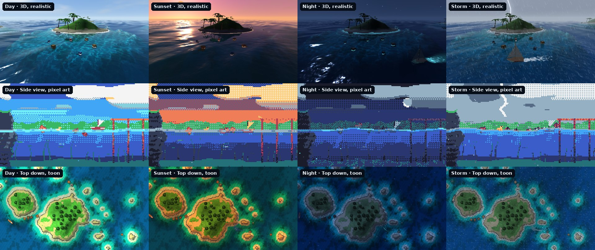

# Water Lite

Clear, stylized real-time water for low-end browser games. It is one JavaScript file with no dependencies, and it runs on WebGL 1 without extensions.


The water is see-through. Everything under the surface is drawn first: the seabed, rocks, seaweed, fish, and the sunken half of anything floating. The water is then drawn from that picture:

- bent by the waves (refraction)
- tinted by how much water the light passes through, with red fading first, so shallow water over sand turns turquoise and deep water turns blue
- lit by moving caustics on the bottom
- marked with foam where it meets the shore
- shading the bottom under boats and crates

The simulation is identical in every art style; only the drawing changes. A pixel-art game gets the same clear shallows, buoyancy, wakes and ripples as a realistic one. Four moods (day, sunset, night and storm) and rain work in every view and style.

## Views

- **`3d`: islands in a lagoon.**
  - Beaches, palms and rocks.
  - Shallow water you can see the sand through, then a reef edge dropping to deep blue.
  - Gerstner waves from a wind spectrum, calmed inside the reef. The CPU reads the same heights, so objects float on the waves you see.
  - Reflections of the sky and of the islands.
- **`side`: a 2D side view for platformers.**
  - The surface is a row of springs on top of a swell.
  - Through it you see a reef, seaweed swaying, fish that dart away from splashes, a cliff and dock posts reaching the seabed, and light shafts.
  - Crates, barrels, ducks and boats float, tip, right themselves and splash when they drop in.
  - Near the surface the water also mirrors the world above it.
- **`top`: a 2D top-down view for RPGs and strategy games.**
  - The seabed shows through the shallows.
  - Ripples follow a wave equation and bounce off coastlines.
  - Waves wash up the beach and leave wet sand. Rock heads poke out with foam around them.
  - Fish swim in the shallows, and a boat leaves a wake. Floating things cast shadows on the bottom.

## Art styles

`realistic`, `toon`, `pixel`, `lowpoly`, `retro` (PS1-style: 15-bit colour, dithering, vertex wobble, scanlines) and `ink` (pen on paper, with hatching and map-style coastlines).

- **Pixel art:** the scene renders at low resolution and is scaled up in whole pixels. Palettes are PICO-8, Sweetie 16, Game Boy, Ocean 8 and 1-bit. Colour is saturated before it snaps to the palette, and dithering only appears where two palette colours meet.
- **Toon and pixel:** water colour comes in clean steps of depth, with crisp foam and caustics.

## Time of day and weather



Set `mood` to `'day'`, `'sunset'`, `'night'` or `'storm'`:

- **Sunset:** a low sun with a glitter path on the sea, and a sky that runs from indigo through rose to orange.
- **Night:** a moon, stars (reflected in the water too), and moonlight that drains colour from land and objects. Foam, wakes, splashes and rain rings glow blue-green, like bioluminescent plankton.
- **Storm:** an overcast sky, stronger wind and waves, murkier water, rain, and lightning. Each strike flashes the whole scene, draws a bolt in the 3D and side views, and fires a `lightning` event so you can play thunder.

The mood moves the sun or moon unless you set `sunElevation` or `sunAzimuth` yourself.

Every style keeps its own look. Palette styles get a gentler mood, so dark scenes land on the palette's dark colours instead of dithering between them, and the ink style becomes chalk on a dark board at night.

`rain` goes from 0 to 1, and -1 (the default) uses the mood's own: storms rain, the others don't. Rain draws:

- streaks at the game's own resolution, so pixel styles get pixel rain
- rings spreading on the 3D sea and the top-down water
- drops landing in the top view's ripple simulation, and little kicks and spray on the side view's surface

Lightning:

- `lightning` sets random strikes a minute. -1 (the default) uses the mood's own: about 8 in a storm, none otherwise. 0 turns random strikes off, and any other number works in any mood, for a dry thunderstorm at sunset.
- Call `water.lightning(strength, x)` to strike now, in any mood. `x` runs from 0 to 1 across the view.

## Try it

Open `lite/index.html` in a browser. The demo has every option, and **Copy code** gives you the exact `new WaterLite(...)` call for what you see.

On a phone the settings fold into a sheet at the bottom, so the water stays in view. In the top view, press and hold to steer the boat toward your finger, or use WASD and the arrow keys on a keyboard.

## Use it

```html
<canvas id="water" style="width: 100%; height: 100%"></canvas>
<script src="water-lite.min.js"></script>
<script>
  var water = new WaterLite(document.getElementById('water'), { mode: 'top', style: 'pixel' });
  var last = performance.now();
  function frame(now) {
    water.update((now - last) / 1000);   // seconds; capped at 0.1 internally
    water.render();                      // sizes the canvas from its CSS size
    last = now;
    requestAnimationFrame(frame);
  }
  requestAnimationFrame(frame);
</script>
```

### In an existing game

- **Water as a layer.** Create the engine with `{ transparent: true, scenery: false }` and put its canvas above or below your game canvas.
  - 3D: draws the sea alone.
  - Side view: the sky is transparent and the water is a translucent tint over whatever is behind it.
  - Top view: the land is transparent.
- **Your own physics.** `water.sample(x, z)` returns the surface at a point:
  - 3D: `{ height, normal }` at world `x, z`.
  - Side view: `{ height }` at `x` in view units (up is positive).
  - Top view: the ripple height at world `x, y`.
- **Things floating.** `water.addFloater(x, y, { kind, size, density })` adds a body that the engine simulates and draws.
  - Side view: `crate`, `barrel`, `duck`, `boat`. They push each other apart, and nothing balances on a floating crate for long.
  - Top view: `crate`, `barrel`. They bump into each other, and the boat shoves them out of its way.
  - 3D: `crate`, `barrel`, `buoy`.
- **Your own 3D islands.** `islands: [{ x, z, r, hill }, ...]` in metres replaces the layout made from `seed`.
  - The terrain grows to fit them.
  - The boat circles the first island.
  - Up to six islands calm the waves inside their reefs.
- **Splashes.** `water.splash(x, y, power, radius)` makes waves, ripples or foam, and scares nearby fish.
- **Your own map.** `land: function (u, v) { return isLand(u, v); }` gives the top view your tilemap, with `u` and `v` running from 0 to 1 across the map. The function can also return a height. Beaches, the shelving seabed, coastline foam and depth colours all come from it.
- **Steering the boat.** In the top view, set `water.input.up`, `.down`, `.left` and `.right` to true or false. The demo maps WASD and the arrow keys to these. `water.boat` is the boat of the current view (its `x`, `y` in the top view, `x`, `z` in 3D), or null.
- **Sound and effects.** `water.on(type, fn)` and `water.off(type, fn)`:
  - `'splash'` gives `{ mode, x, y, power, radius }` (`z` instead of `y` in 3D) for drops, things falling in, and your own `splash()` calls. The boat's wake and rain are quiet, so you only hear real splashes.
  - `'lightning'` gives `{ strength, x }`, with `x` from 0 to 1 across the view for panning the thunder.
  - `'contextlost'` and `'contextrestored'`: see below.

The demo's **Sound** button makes surf, rain, splashes and thunder with WebAudio from these events.

### Cameras for 2D levels

- **Side view.** Set `worldWidth` wider than 480, for example 1440, and move `water.camera2d.x`, the world x at the middle of the screen.
  - The hills, reef and clouds scroll slower than the water, for depth.
  - The cliff stays at the left end of the world and the dock at the right end.
  - Floating things, fish and splashes live in world units.
- **Top view.** Set `mapSize: [w, h]` for a bigger map; it gets more islands, floating things and fish.
  - The map keeps full detail up to nine times the standard area, for example 480 × 270.
  - Ripples are only simulated around the view, so a zoomed-in big map costs about what the standard one does.

  Then:
  - `zoom` above 1 shows part of the map (2 shows half its width).
  - `water.camera2d.x` and `.y` set the middle of the view. The view always stays inside the map.
  - `water.camera2d.follow = water.boat` (or your player, or anything with `x` and `y`) makes the camera glide after it.
- In pixel styles, scrolling moves in whole game pixels, so nothing shimmers.
- `screenToWorld()` and `addFloater()` take the camera into account.

### Performance on unknown devices

- **`quality: 'auto'`** runs `low`'s simulation and adjusts the drawing resolution from frame times, between 40 % and 100 % of the canvas:
  - It drops the 3D island reflections when it has to go low.
  - It assumes you render every animation frame. If drawing less doesn't speed things up (the game is CPU-bound, or capped at 30 fps), it notices and aims for the rate you actually run.
- **`water.stats`** gives `{ fps, scale, lowW, lowH, px, gpu, highp }`: the measured frame rate, the drawing scale, the internal resolution, the GPU's name, and whether its fragment shaders have high precision.
- **Old phones.** Some old phone GPUs only have medium precision in fragment shaders, which loses a growing time value within a minute or two. Every animation phase is therefore worked out on the CPU and handed to the shaders as a small number, so animation stays smooth there. The 3D sea also takes its texture coordinates relative to a point near the camera.
- **`water.benchmark(frames)`** times each preset on the device and returns `{ ms: { potato, low, medium, high }, recommended }`.
  - `recommended` is the best preset that leaves 40 % of the frame for your game.
  - It blocks for a moment and resets the scene, so run it once before play and keep the result, for example in `localStorage`.
  - The demo's **Test this device** button does this, and names the GPU.

### Lost GPU context

Phones and some drivers take the GPU away (a tab left in the background, a driver reset). Water Lite handles it: frames are skipped while the context is gone, and everything is rebuilt from copies kept on the CPU when it comes back. The simulations keep running, and you get `contextlost` and `contextrestored` events.

### Coordinates

| View | Units | Size |
| --- | --- | --- |
| `3d` | metres, y up, sea level 0 | an island at (0, −42); the camera looks at `water.cam.target` |
| `side` | world units, y down | `worldWidth` wide (480 by default); the view is 480 wide, its height from the canvas aspect; water line at `level` × height |
| `top` | world units (about a metre), y down | `mapSize` (160 × 90 by default); at `zoom` 1 the view covers the canvas without stretching |

`water.screenToWorld(x, y)` converts CSS pixels on the canvas into these units.

## Options

Pass options to the constructor, or change them later with `water.setOptions({...})`.

| Option | Default | What it does |
| --- | --- | --- |
| `mode` | `'3d'` | `'3d'`, `'side'` or `'top'` |
| `style` | `'realistic'` | `'realistic'`, `'toon'`, `'pixel'`, `'lowpoly'`, `'retro'`, `'ink'` |
| `quality` | `'low'` | `'potato'`, `'low'`, `'medium'`, `'high'`, or `'auto'` (see above) |
| `mood` | `'day'` | `'day'`, `'sunset'`, `'night'`, `'storm'` |
| `rain` | `-1` | 0 to 1; -1 uses the mood's own (storms rain) |
| `lightning` | `-1` | random strikes a minute; 0 turns them off; -1 uses the mood's own (about 8 in storms) |
| `clarity` | `1` | how far you see into the water; 2 sees twice as deep |
| `reflections` | `true` | islands mirrored in the 3D sea (from `low` up); the world above mirrored near the surface in the side view |
| `palette` | `'auto'` | `'none'`, `'pico8'`, `'sweetie16'`, `'gameboy'`, `'ocean8'`, `'mono'`; `'auto'` uses the style's own |
| `pixelSize` | `0` | size of one game pixel in CSS pixels; 0 uses the style's own (4 for pixel, 3 for retro) |
| `dither` | `-1` | 0 to 1, how much of each colour transition is dithered; -1 uses the style's own |
| `wind` | `7` | wind speed in m/s, which sets wave size and length |
| `windDir` | `30` | wind direction in degrees |
| `waveHeight` | `1` | multiplies wave height |
| `choppiness` | `0.7` | 0 to 1, how sharp the crests are (3D) |
| `foam` | `1` | multiplies foam; 0 turns it off |
| `colors` | `null` | override any theme colour; see below |
| `sunElevation`, `sunAzimuth` | `42`, `215` | sun position in degrees |
| `scenery` | `true` | false draws only the water |
| `level` | `0.55` | side view: water line as a fraction of the height |
| `land` | `'islands'` | top view: `'islands'`, `'none'`, or `function (u, v)` that returns true or a height |
| `mapSize` | `[160, 90]` | top view: the map's size in world units |
| `zoom` | `1` | top view: 1 shows the whole map, 2 half its width |
| `worldWidth` | `480` | side view: the world's width; wider scrolls with `camera2d.x` |
| `islands` | `null` | 3D: your own layout, `[{ x, z, r, hill }, ...]` in metres; null makes one from `seed` |
| `seed` | `7` | changes waves, islands and the top-view map |
| `floaters`, `boat` | `true` | the built-in floating objects and boat |

Colours you can override:

- **Water:**
  - `deep`: the colour of deep water.
  - `shallow`: lit shallow water.
  - `tint`: the colour water gives to what you see through it. It sets how fast each colour is absorbed, and defaults to `shallow`.
  - `foam`.
- **Sky:** `skyTop`, `skyHorizon` and `sun`.
- **Land and objects:** `sand`, `grass`, `rock`, `wood` and `paint`.
- **Night glow:** `glow`.
- **Ink style:** `paper` and `ink`.

Constructor only: `transparent` (default false) gives the canvas an alpha channel; `preserveDrawingBuffer` (default false) lets you read pixels back after a frame.

Other methods: `resize()`, `config()` (current options as JSON), `clearFloaters()`, `drop(x, y)` (the demo's click), `lightning(strength, x)`, `benchmark(frames)`, `on(type, fn)`, `off(type, fn)`, `dispose()`.

## How it stays cheap

- **Quick to start.**
  - The ripple normals, foam lace, caustics, clouds and noise are made once per page (about 0.1 s on a desktop) as tileable 256 × 256 textures, and shared by every engine on the page. The shaders sample these instead of computing noise per pixel.
  - Shaders are compiled the first time a view needs them, so a game that only uses the top view never compiles the 3D ones.
  - The caustics come from tracing light through the ripples onto a floor, and are sampled with a slow warp so they wobble like real ones.
- **Low resolution.** Each frame is drawn at low resolution: 75 % of the canvas width at `low`, and one sixteenth of the pixels in the `pixel` style. The palette and dither pass runs at that resolution too, then one cheap pass scales it up.
- **A few passes per frame.**
  - 2D views draw two full-screen passes plus a few sprites.
  - 3D draws the island scene into an under-water picture (half size at `potato`, three quarters at `low`, full size above), a half-size reflection picture (from `low` up), then the frame.
  - The terrain mesh has 81 × 81 to 201 × 201 vertices, depending on quality.
- **No heavy features.** No floating-point textures, no depth textures, no multiple render targets, no shadow maps. Shadows of floating things on the seabed are worked out per pixel from their positions.
- **Weather costs little.** A mood only changes colours, so it costs nothing per frame. Stars, glow, rain rings and lightning are skipped when they are off. Rain streaks add one full-screen pass at the low resolution.
- **Small simulations, on the CPU.**
  - Side view: up to 360 spring columns.
  - Top view: a ripple grid of 112 × 63 (`potato`) to 288 × 162 (`high`).
  - Ripples run at a fixed 60 steps a second and the springs at about 120, so they behave the same at 30 fps and 144 fps.
- **Device pixel ratio.** It is capped per preset (1, 1, 1.5, 2).

If a device struggles, try `quality: 'potato'` or a pixel style: both cut the pixels drawn by four or more.

About 166 KB of source, 117 KB minified, 41 KB gzipped. Most of that is shader text.

## Honest limits

- **3D**
  - The sea is a sum of Gerstner waves, not an FFT ocean. For that, use the main lab in this repository.
  - Islands are round with noisy coasts; there are no other shapes yet.
  - Floating objects use a spring float, not full rigid-body physics.
  - Far away, the line where beach meets sea can shimmer a little.
- **Side view**
  - The surface is a height field, so waves cannot curl over.
  - Bodies push each other apart as boxes that ignore their tilt, so a tipped crate can overlap a neighbour a little.
  - The scenery (cliff, dock, reef) is fixed. Turn `scenery` off to draw your own.
- **Top view**
  - Ripples are a wave equation, not shallow-water flow, so there are no currents.
  - Maps bigger than nine times the standard area get a coarser grid. Zoomed far in, coasts stay organic but ripples get soft.
  - On a tall phone screen, the map is cropped to a narrow strip at zoom 1; follow the boat or your player.
- **All views**
  - Built-in objects are simple shapes. For your own sprites, use `sample()` and draw them yourself.
  - On very old phones whose GPUs have only medium precision in fragment shaders, fine texture detail far from the camera can look blocky. Animation stays smooth.
  - Without `OES_standard_derivatives`, low poly falls back to smooth shading and ink lines get a fixed width.
- **Testing.**
  - Headless Chromium with a software renderer: `tools/lite-smoke.mjs` (38 checks) and `tools/lite-shots.mjs`.
  - One real laptop GPU, Intel UHD Graphics (Direct3D 11 through ANGLE): all 72 view, style and mood combinations render cleanly. At 1280 × 720, a `low` frame takes about 8 ms in the 2D views and 13 ms in 3D, measured with a GPU sync after each frame.
  - The demo was checked in an emulated phone (Pixel 5 screen and touch). The medium-precision path can't be tried on a desktop GPU, which always computes in full precision.
  - Not yet tried on a range of real low-end phones. Reports are welcome: the demo's **Test this device** gives the numbers and the GPU's name.

## Building

```sh
node lite/build.mjs          # lite/dist/water-lite.min.js and a single-file lite/dist/index.html
node tools/lite-shots.mjs    # screenshots of every view and style into media/shots/
node tools/lite-smoke.mjs    # API, physics and rendering checks
```

`build.mjs` minifies with esbuild when it is installed; set `ESBUILD=/path/to/esbuild/lib/main.js` to point it at one. Without esbuild it copies the source unminified.

MIT License, like the rest of Ocean Water Lab.
